# Windows EFS File Encryption & Certificate-Based Access Lab

  

**CompTIA A+ Core 2 | Lab 19.2.11: Encrypt Files with EFS**  
**Project type:** Windows security administration / file encryption / authorized user access  
**Result:** **100% — both required tasks passed**

## Project overview

This hands-on training lab simulates a shared workplace computer with sensitive financial reports. The goal was to encrypt the `D:\Finances` folder and its contents using Windows Encrypting File System (EFS), then authorize **John** to decrypt **only** `D:\Finances\2023report.xlsx` by adding his EFS certificate.

> **Scope:** This is a simulated training environment, not a production deployment. Screenshots document the performed actions and the lab's final grading result.

## Objectives and verification

| Requirement | Observed outcome |
| --- | --- |
| Encrypt `D:\Finances` and all its contents | Completed; encrypted folder and file padlock indicators visible; grader passed |
| Add John as an authorized EFS user for `2023report.xlsx` | Completed; John listed alongside Administrator in file access dialog; grader passed |
| Final evaluation | **100%** |

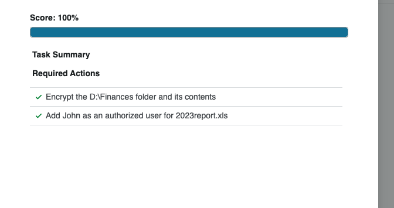

## Lab environment

- Windows 11 graphical interface (training machine)
- File Explorer, folder/file Properties, Advanced Attributes
- NTFS Encrypting File System (EFS)
- Existing EFS certificates for Administrator and John, supplied in the lab
- Data volume: `D:`
- Target folder: `D:\Finances`
- Target file: `D:\Finances\2023report.xlsx`

## Step-by-step walkthrough with screenshots

### Step 1 — Review the security requirements

The scenario required protecting financial files on a shared computer and authorizing a second user for one report. The initial grader showed both tasks incomplete.

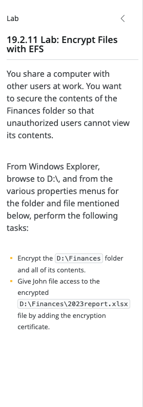
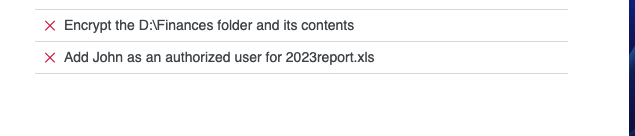

**Why:** Identify the required scope and validation criteria before changing security settings.

### Step 2 — Locate the financial data

1. Open **File Explorer**.
2. Navigate to **This PC**.
3. Open **Data (D:)**.
4. Locate the **Finances** folder.

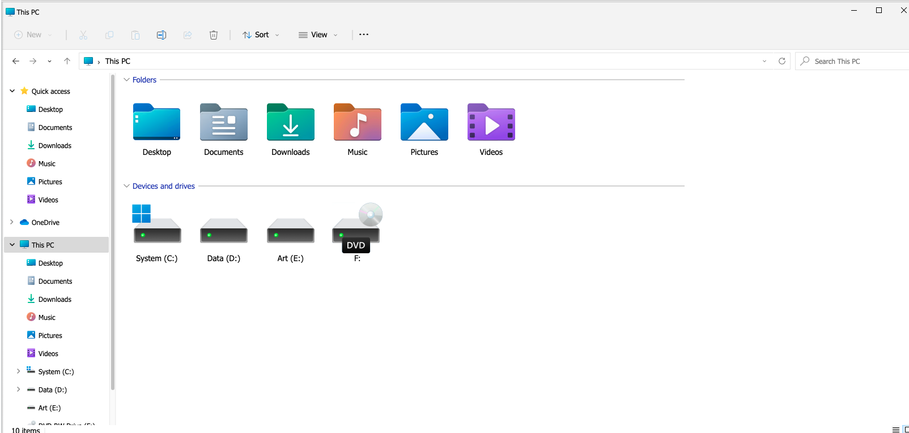
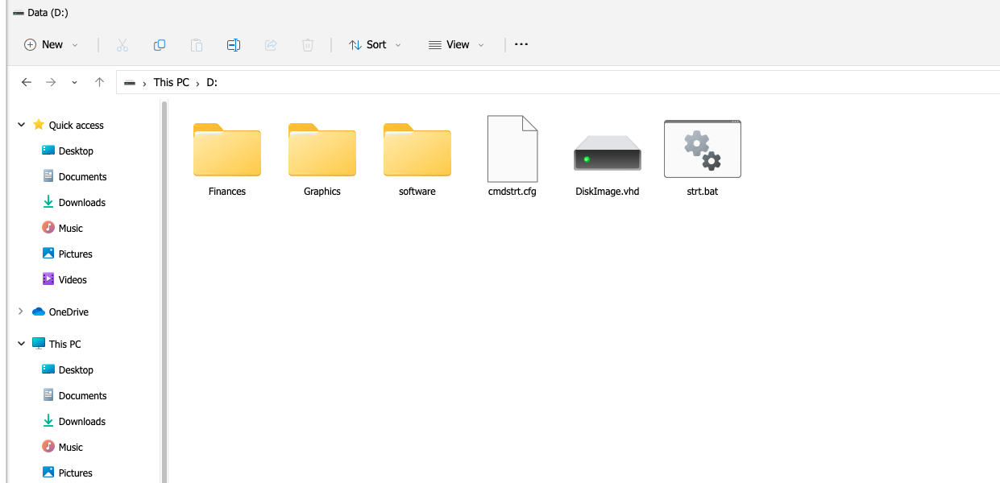

**Why:** EFS is configured on the actual folder and files, not from the general Windows Security antivirus settings.

### Step 3 — Open folder properties

1. Right-click **Finances**.
2. Choose **Properties** (available in the Windows 11 context menu).
3. On the **General** tab, select **Advanced...**.

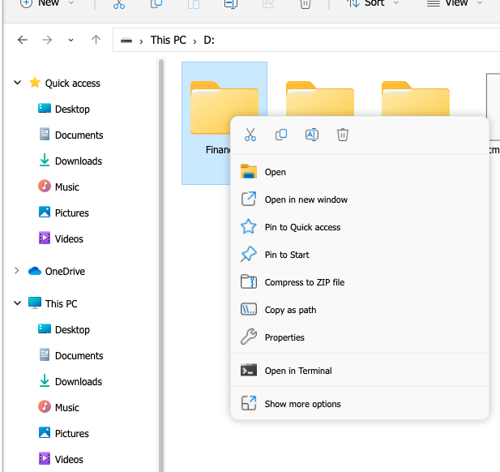
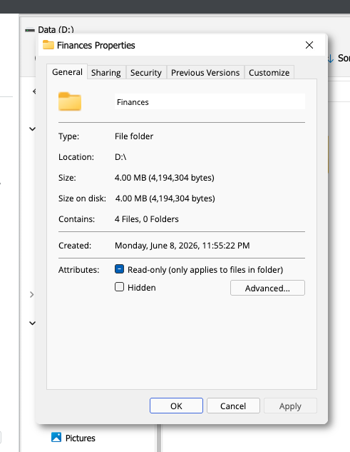

**Why:** Advanced Attributes exposes NTFS file and folder encryption settings.

### Step 4 — Enable EFS on the folder and its contents

1. In **Advanced Attributes**, select **Encrypt contents to secure data**.
2. Click **OK**, then **Apply** or **OK** in folder Properties.
3. When prompted to choose the scope, apply the change to **this folder, subfolders, and files**.
4. Return to File Explorer and confirm the folder displays an encryption padlock indicator.

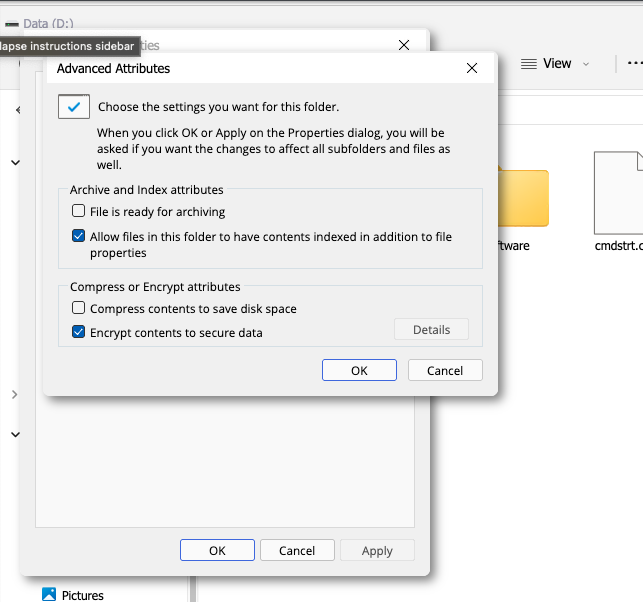
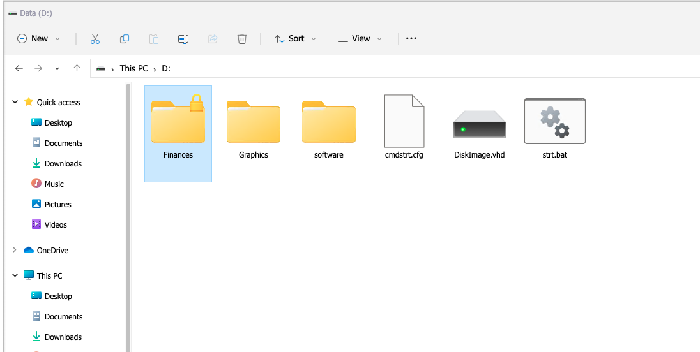

**Why:** Encrypting the contents, not merely the parent folder, ensures the existing financial reports are covered. The scope choice is inferred from the required task and verified final result; that specific prompt was not captured in the supplied screenshots.

### Step 5 — Inspect the encrypted reports

1. Open `D:\Finances`.
2. Observe the encrypted file indicators on the four Excel reports (`2020report.xlsx` through `2023report.xlsx`).
3. Right-click **2023report.xlsx** and open **Properties**.

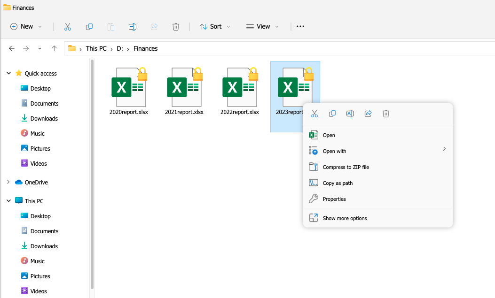
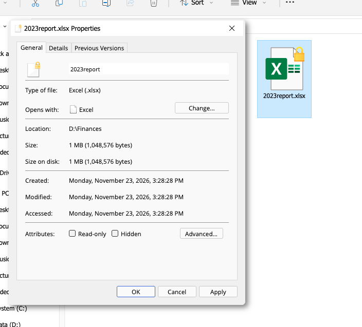

**Why:** This confirms the existing files are encrypted before adjusting access to the specific report.

### Step 6 — Open EFS certificate access settings

1. From the report's **General** tab, click **Advanced...**.
2. Confirm **Encrypt contents to secure data** is checked.
3. Click **Details**.
4. Review the list of users who can access the encrypted file. Initially, only **Administrator** appeared.

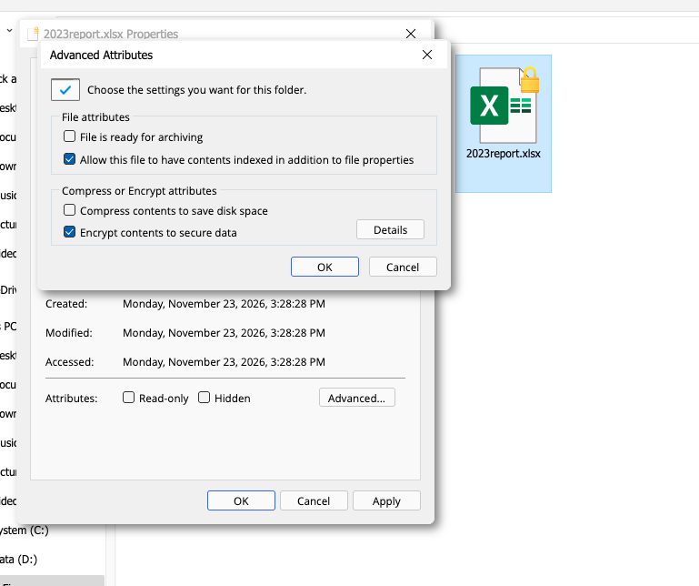
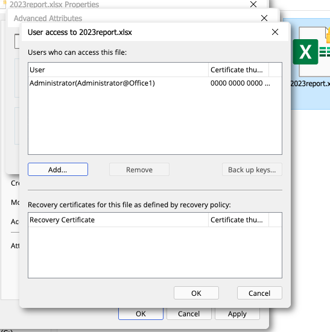

**Why:** EFS access uses encryption certificates. This is separate from NTFS permissions and file sharing permissions.

### Step 7 — Authorize John for the single report

1. In **User access to 2023report.xlsx**, click **Add...**.
2. Select the existing **John** certificate from the EFS certificate list.
3. Click **OK**.
4. Verify **John** now appears in the file's authorized-user list alongside **Administrator**.
5. Close the dialogs using **OK** to retain the change.

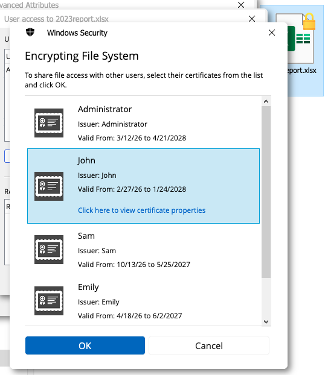
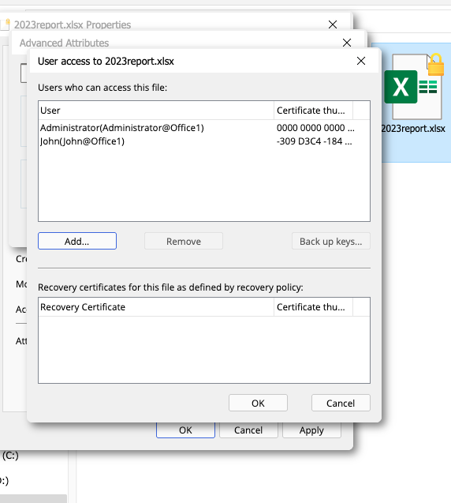

**Why:** Adding John's certificate enables him to decrypt the selected report. It does **not** automatically grant him NTFS read permissions or EFS access to other files in the folder.

### Step 8 — Verify completion

Return to the lab's grading interface and evaluate the work. The final screen showed **100%** with green checks for:

- Encrypt the `D:\Finances` folder and its contents.
- Add John as an authorized user for `2023report.xlsx`.


## Outcome

**Successfully completed both required tasks (100%).** The lab demonstrated Windows EFS folder encryption and certificate-based authorization for a single encrypted file. The screenshots show encrypted folder/file indicators, John's certificate selection, his presence in the authorized-user list, and the successful grading result.

## What I learned

- How to navigate Windows 11 File Explorer and Advanced Attributes to configure EFS.
- The distinction between **encrypting a folder and its existing contents** and encrypting a single file.
- How EFS uses user certificates to enable decryption of protected data.
- How to add another authorized EFS user without sharing the encryption key or disabling encryption.
- How to verify configuration changes using both the GUI and an independent lab assessment.

## Security and troubleshooting notes

- **EFS is not BitLocker:** EFS encrypts individual NTFS files/folders; BitLocker encrypts volumes.
- **Certificate management matters:** Losing the relevant EFS private key can make data unrecoverable. In a real organization, follow approved certificate backup and recovery-agent procedures.
- **NTFS permissions still apply:** EFS authorization alone does not guarantee file access.
- **Do not overgrant:** Authorize users only for the files they require.
- **Check compatibility:** EFS requires a supported Windows edition and NTFS; it is not available on every Windows edition or file system.
- **Recovery planning:** The screenshot's recovery certificate list is empty; this lab did not establish an organizational data-recovery agent.
- **Verification scope:** The 100% grader confirms the lab requirements, not a separate real-world login test as John.

## Repository structure

```text
Windows-EFS-File-Encryption-Lab/
├── README.md
└── screenshots/
    ├── 01-lab-objectives.png
    ├── 02-initial-requirements.png
    ├── 03-this-pc-drives.png
    ├── 04-data-drive.png
    ├── 05-finances-context-menu.png
    ├── 06-folder-properties.png
    ├── 07-folder-advanced-encryption.png
    ├── 08-encrypted-folder.png
    ├── 09-encrypted-files.png
    ├── 10-report-properties.png
    ├── 11-report-advanced-attributes.png
    ├── 12-current-efs-users.png
    ├── 13-select-john-certificate.png
    ├── 14-john-authorized.png
    └── 15-final-100-percent-score.png
```

## Skills demonstrated

`Windows 11` · `Endpoint Security` · `EFS` · `NTFS` · `File Encryption` · `Certificate-Based Access` · `Security Administration` · `IT Support` · `CompTIA A+ Core 2`

---

*Hands-on lab portfolio project documenting a simulated Windows cybersecurity task. No actual financial data is included in this repository.*
